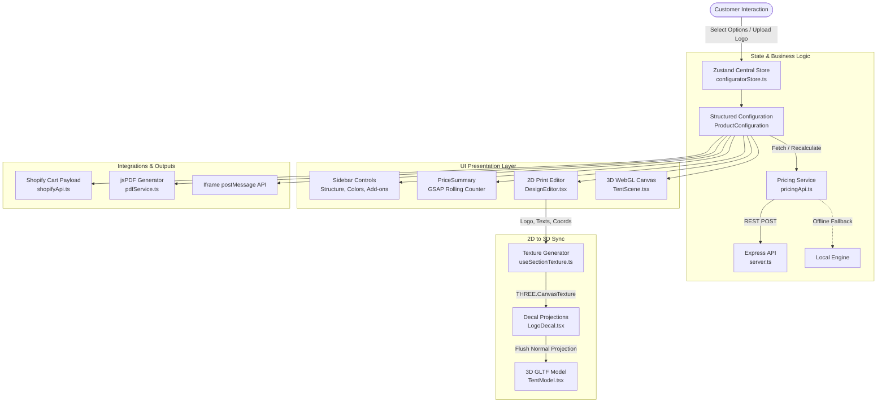

# Interactive Custom Canopy Tent Configurator

[](https://react.dev/)
[](https://www.typescriptlang.org/)
[](https://threejs.org/)
[](https://vitejs.dev/)
[](https://tent-configurator-rho.vercel.app/)
[](https://tent-configurator-api.onrender.com/)
[](https://opensource.org/licenses/MIT)

A high-performance, responsive 3D/2D interactive commercial product configurator inspired by [MVP Visuals](https://mvpvisuals.com/products/10x10-custom-canopy-tent). Built with **React 19**, **TypeScript**, **Three.js / React Three Fiber**, **GLSL WebGL Shaders**, **GSAP Animations**, and **Tailwind CSS v4**.

Features real-time dye sublimation print simulation, custom WebGL procedural shader environments, 2D-to-3D bidirectional synchronization, GSAP camera flight and price rolling animations, dynamic API-driven pricing, Shopify cart integration, and production-ready PDF specification generation.

---

## 📑 Table of Contents

- [Key Features](#-key-features)
- [Live Demo & Reference](#-live-demo--reference)
- [System Architecture](#-system-architecture)
- [2D/3D Synchronization Engine](#-2d3d-synchronization-engine)
- [WebGL & GLSL Shaders](#-webgl--glsl-shaders)
- [GSAP Animation Suite](#-gsap-animation-suite)
- [Dynamic Pricing Engine](#-dynamic-pricing-engine)
- [Shopify Integration Architecture](#-shopify-integration-architecture)
- [Production Specification PDF](#-production-specification-pdf)
- [Iframe Embedding Protocol](#-iframe-embedding-protocol)
- [Environment Configuration](#-environment-configuration)
- [Getting Started & Installation](#-getting-started--installation)
- [Project Structure](#-project-structure)
- [Reusability & Extensibility](#-reusability--extensibility)

---

## 🌟 Key Features

### 1. Photorealistic 3D WebGL Configurator
- **Physically Based Rendering (PBR)**: Live fabric recoloring via standard materials, stripping baked diffuse color textures to ensure pure dye sublimation color accuracy while preserving the microscopic polyester fabric weave and normal maps.
- **Model Support**: Fully rigged and calibrated for available commercial frame assets:
  - `8 × 8 ft Custom Canopy` (`Tent_8_8.glb`)
  - `6.5 × 6.5 ft Custom Canopy` (`Tent 6.5_6.5.glb`)
  - `5 × 5 ft Custom Canopy` (`Tent_5_5.glb`)
- **Procedural 3D Wall Hardware**: Add single back walls, 3-sided enclosure walls, or half-walls with aluminum support rails.
- **Canopy-Only Mode**: Dynamically collapses and hides frame hardware for replacement top visualization.

### 2. Custom WebGL GLSL Shader Environments
- **Procedural Grass Land (`src/shaders/backgroundShader.ts`)**: Procedural dual-tone Voronoi turf blades with outdoor park ambient lighting.
- **Procedural Tech Park**: Architectural granite pavers with mortar joints, stone aggregate, and per-tile color variation.
- **Clean Studio**: High-end cyclorama studio dome with spotlight gradient and dithering to eliminate 8-bit color banding.

### 3. 2D Print Artwork Template Editor & 3D Synchronization
- **Independent Customization Sections**:
  - **Canopy Roof**: Front sloping trapezoid peak (Primary Brand Logo).
  - **Front Valance**: Hanging ribbon flap (Website URL / Tagline).
  - **Left Wall**: Exterior left banner.
  - **Right Wall**: Exterior right banner.
- **Image Upload & Proportional Scaling**: Drag-to-resize corner handles, proportional Scale slider (15% to 100%), and natural aspect ratio preservation.
- **Built-in Brand Logos**: 1-click sample logos (*Summit Outdoors*, *Alpha Tech*, *Pure Energy*) for testing.
- **Custom Typography**: Editable text lines with real-time color pickers, font sizing, and rotational controls.
- **Real-Time Synchronous Texture Generation**: Decoded image caching (`imageCache`) in `useSectionTexture.ts` enables 60fps drag synchronization to the 3D model with zero latency.

### 4. Dynamic Pricing Engine
- Decoupled pricing service via `POST /api/pricing` (with automatic fallback to local computation if backend is offline).
- Dynamic line items: base canopy size, frame tiers, wall setups, accessory packages, turnaround speed (Standard 5-Day vs. Rush 2-Day), and custom artwork print fees.

### 5. Shopify Cart Integration
- Adheres to Shopify's standard `/cart/add.js` payload specification.
- Translates user choices into structured Line Item Properties (`_configuration_id`, `Size`, `Frame`, `Walls`, `Turnaround`, `_production_pdf_spec`).
- Interactive Shopify Cart modal inspector to preview the exact JSON payload.

### 6. Production Specification PDF Generation
- Creates print-ready vectorized production proofs using **jsPDF**.
- Includes order metadata, CPAI-84 / NFPA-701 flame certifications, Pantone/Hex color codes, artwork coordinate matrices, and an itemized bill of materials.

---

## 🎯 Live Demo & Reference

- **Frontend Live Demo**: [https://tent-configurator-rho.vercel.app/](https://tent-configurator-rho.vercel.app/)
- **Backend API (Render)**: [https://tent-configurator-api.onrender.com/](https://tent-configurator-api.onrender.com/)
- **API Health Check**: [https://tent-configurator-api.onrender.com/api/health](https://tent-configurator-api.onrender.com/api/health)
- **Reference Product**: [MVP Visuals 10x10 Custom Canopy Tent](https://mvpvisuals.com/products/10x10-custom-canopy-tent)
- **Local Dev URL**: `http://localhost:5174/`
- **Local Backend API**: `http://localhost:3001/`

---

## 🏛️ System Architecture

The configurator is designed with a unidirectional data flow and strict separation of concerns:



---

## 🔄 2D/3D Synchronization Engine

A core engineering challenge in 3D product customization is mapping planar 2D vector/raster artwork onto complex non-planar 3D geometry without distortion, z-fighting, or clipping.

### The Problem
- Tent roofs are angled pyramids with trapezoidal faces, while valances are thin vertical ribbons.
- Generic square textures stretch or distort non-square logos.
- Standard 3D decal meshes often suffer from z-fighting or penetrate interior folds when the user navigates around the model.

### The Solution
1. **Geometric Trigonometry Calibration (`MODEL_SPECS`)**:
   Vertex normals and face angles were calculated directly from the GLTF mesh vertices:
   - **8×8 Tent**: Face center $(Y=2.056\text{ m}, Z=0.635\text{ m})$, slope angle $\theta = -48.6^\circ$ ($-0.849\text{ rad}$).
   - **6.5×6.5 Tent**: Face center $(Y=1.625\text{ m}, Z=0.406\text{ m})$, slope angle $\theta = -41.4^\circ$ ($-0.723\text{ rad}$).
   - **5×5 Tent**: Face center $(Y=1.666\text{ m}, Z=0.406\text{ m})$, slope angle $\theta = -43.8^\circ$ ($-0.764\text{ rad}$).

2. **Proportional Aspect-Ratio Scaling**:
   ```typescript
   export function calculateLogoDimensions(scalePercent: number, imgAspect: number, sectionAspect: number) {
     const aspectFactor = imgAspect / sectionAspect;
     let maxW = 90;
     let maxH = 90;

     if (aspectFactor >= 1) {
       maxW = 90;
       maxH = 90 / aspectFactor;
     } else {
       maxH = 90;
       maxW = 90 * aspectFactor;
     }

     const s = Math.max(10, Math.min(100, scalePercent)) / 100;
     return {
       width: Number((maxW * s).toFixed(1)),
       height: Number((maxH * s).toFixed(1)),
     };
   }
   ```

3. **Zero Z-Fighting WebGL Configuration (`LogoDecal.tsx`)**:
   - `depthTest: true` and `depthWrite: false`
   - `polygonOffset: true`, `polygonOffsetFactor: -6`, `polygonOffsetUnits: -6`
   - `side: THREE.FrontSide`: Eliminates backface visibility when orbiting behind the tent.
   - `toneMapped: false`: Keeps company branding logos crisp and color-accurate under all lighting angles.

4. **Synchronous Image Decoding (`useSectionTexture.ts`)**:
   Maintains an in-memory `Map<string, HTMLImageElement>` cache. Once an image is decoded, all position, scale, and rotation adjustments redraw synchronously to the `THREE.CanvasTexture` with zero flicker.

---

## 🎨 WebGL & GLSL Shaders

The background environment runs custom GLSL vertex and fragment shaders located in [src/shaders/backgroundShader.ts](file:///home/prakash/Programs/Projects/tent-configurator/src/shaders/backgroundShader.ts):

### 1. Grass Land Shader (`grassland`)
- Procedural 2D Voronoi cellular noise simulating grass blades.
- Dual-color gradient interpolation between `#3a6b35` and `#244c20`.
- Atmospheric depth fog blending with sky dome lighting.

### 2. Tech Park Shader (`techpark`)
- Procedural architectural grid with mortar joint calculation.
- High-frequency procedural noise simulating granite aggregate.
- Subtle per-tile luminance variation to simulate individual stone pavers.

### 3. Studio Cyclorama (`studio`)
- Infinite studio cyc wall gradient with radial spotlight falloff.
- Integrated pseudo-random high-frequency dither to eliminate 8-bit color banding.

---

## 🎬 GSAP Animation Suite

The application leverages **GSAP 3** for polished, interactive transitions:

1. **Page Load Stagger**: Header, Sidebar, 3D Viewport, and Summary enter with staggered easing (`power2.out`).
2. **3D Model Entrance & Size Switch**: Changing tent size triggers a scale bounce (`back.out(1.5)`) and subtle $Y$-axis rotation reset.
3. **PBR Color Morphing**: Transitioning fabric colors morphs RGB values smoothly using `gsap.to(material.color, { r, g, b, duration: 0.45 })`.
4. **Cinematic Camera Flight**: Preset buttons (*Front*, *3/4 Perspective*, *Side*, *Top*) smoothly tween camera position and orbit target coordinates.
5. **Real-Time Rolling Price Counter**: In `PriceSummary.tsx`, numeric price changes smoothly roll from the old total to the new total with an elastic scale pulse.

---

## 💰 Dynamic Pricing Engine

Pricing is calculated dynamically based on user selections:

| Item | Options | Price Impact |
|---|---|---|
| **Base Size** | 5×5 ft / 6.5×6.5 ft / 8×8 ft | $599 / $699 / $799 |
| **Frame** | Standard Aluminum / Light Aluminum / Canopy Only | Included / +$150 / -$100 |
| **Full Walls** | None / 1 Wall (Single/Double) / 3 Walls (Single/Double) | $0 / +$90 / +$140 / +$240 / +$360 |
| **Half Walls** | None / 2 Half Walls (Single/Double) | $0 / +$130 / +$190 |
| **Accessories** | Sandbags / Roller Bag / Stakes / LED Light Kit | +$45 / +$75 / +$25 / +$60 |
| **Turnaround** | Standard 5-Day / Rush 2-Day | Included / +$99 |
| **Custom Artwork** | Custom Logo Sublimation / Custom Text Lines | +$25 per logo / +$10 per line |

---

## 🛒 Shopify Integration Architecture

When a customer checks out, the configuration is translated into a Shopify line item payload:

```json
{
  "items": [
    {
      "id": "tent-8x8",
      "quantity": 1,
      "price": 99400,
      "properties": {
        "_configuration_id": "CONF-9X82KA",
        "Tent Size": "8 x 8 ft Custom Canopy",
        "Frame Hardware": "Standard Aluminum Frame",
        "Wall Configuration": "3 full walls (double-sided)",
        "Canopy Color": "#dc2626",
        "Wall Color": "#10b981",
        "Turnaround Time": "Standard 5-Day Production",
        "Accessories": "sandbags, roller-bag",
        "Custom Logo Elements": 1,
        "Custom Text Elements": 1,
        "_production_pdf_spec": "https://cdn.shopify.com/orders/specs/CONF-9X82KA.pdf"
      }
    }
  ]
}
```

The configurator includes a **Shopify Modal Inspector** that allows reviewers to inspect and copy this payload in real time.

---

## 📄 Production Specification PDF

Clicking **PDF** in the top navigation generates an engineering proof sheet using `jsPDF`:
- Order Identification & Timestamp
- CPAI-84 & NFPA-701 Fire Retardant Certification
- 600D UV50+ Waterproof Polyester Material Specs
- Pantone / Hex Codes for Canopy & Wall Fabric
- Itemized Bill of Materials (BOM) & Total Investment
- Section-by-Section Artwork Coordinate Matrices ($X, Y, \text{Width}, \text{Height}, \text{Rotation}$)

---

## 📐 Iframe Embedding Protocol

To embed the configurator into an external website, Shopify store, or CMS:

```html
<iframe
  src="https://tent-configurator-rho.vercel.app/?embed=true"
  width="100%"
  height="750px"
  frameborder="0"
  allow="fullscreen"
></iframe>
```

### `postMessage` Event API

The configurator communicates bidirectionally with the host window:

#### Inbound Commands (Host $\to$ Iframe)
```javascript
// Request current configuration
iframe.contentWindow.postMessage({ type: "GET_CONFIGURATION" }, "*");

// Apply a saved configuration
iframe.contentWindow.postMessage({ type: "SET_CONFIGURATION", payload: savedConfig }, "*");

// Reset to default configuration
iframe.contentWindow.postMessage({ type: "RESET_CONFIGURATION" }, "*");

// Trigger add to cart
iframe.contentWindow.postMessage({ type: "TRIGGER_ADD_TO_CART" }, "*");
```

#### Outbound Events (Iframe $\to$ Host)
```javascript
window.addEventListener("message", (event) => {
  if (event.data.type === "CONFIGURATION_COMPLETED") {
    console.log("Configuration added to cart:", event.data.payload);
  }
});
```

---

## ⚙️ Environment Configuration

Environment files are safely excluded in [.gitignore](file:///home/prakash/Programs/Projects/tent-configurator/.gitignore).

### Frontend ([.env](file:///home/prakash/Programs/Projects/tent-configurator/.env))
```env
# Production Backend API on Render
VITE_PORT=5174
VITE_API_URL=https://tent-configurator-api.onrender.com
VITE_APP_TITLE=MVP Visuals Custom Canopy Configurator

# For local development against local server:
# VITE_API_URL=http://localhost:3001
```

### Backend ([server/.env](file:///home/prakash/Programs/Projects/tent-configurator/server/.env))
```env
# Production Environment
PORT=3001
NODE_ENV=production
CORS_ORIGIN=https://tent-configurator-rho.vercel.app,http://localhost:5174
SHOPIFY_STORE_DOMAIN=mvpvisuals-demo.myshopify.com
```

---

## 🚀 Getting Started & Installation

### Prerequisites
- **Node.js**: v18+ (tested on Node v24)
- **npm**: v9+

### Quick Start

```bash
# 1. Clone repository
git clone https://github.com/your-username/tent-configurator.git
cd tent-configurator

# 2. Install dependencies
npm install
cd server && npm install && cd ..

# 3. Setup environment files
cp .env.example .env
cp server/.env.example server/.env

# 4. Build the backend server
npm run build --prefix server

# 5. Start development servers
# Terminal 1: Express API Server (Port 3001)
node server/dist/server.cjs

# Terminal 2: Vite Dev Server (Port 5174)
npm run dev
```

Open your browser at **http://localhost:5174/**.

### Verification & Quality Checks

```bash
# Run Oxlint (0 warnings, 0 errors)
npm run lint

# TypeScript compilation & Vite production build
npm run build
```

---

## 📂 Project Structure

```
tent-configurator/
├── .env.example                  # Frontend environment template
├── .gitignore                    # Comprehensive git exclusion rules
├── index.html                    # Single-page application entry HTML
├── package.json                  # Root dependencies (React 19, Three.js, GSAP)
├── tsconfig.json                 # TypeScript strict configuration
├── vite.config.ts                # Vite config with integrated dev mock API
├── public/
│   ├── favicon.svg               # SVG application icon
│   └── models/
│       ├── Tent_5_5.glb          # 5x5 ft commercial tent 3D asset
│       ├── Tent 6.5_6.5.glb      # 6.5x6.5 ft commercial tent 3D asset
│       └── Tent_8_8.glb          # 8x8 ft commercial tent 3D asset
├── src/
│   ├── App.tsx                   # Top-level application component
│   ├── main.tsx                  # React DOM mount entry point
│   ├── config/
│   │   ├── options.ts            # Options catalog (frames, walls, turnaround)
│   │   └── products.ts           # Product catalog and pricing base
│   ├── types/
│   │   ├── configuration.ts      # Domain models for selections & decals
│   │   ├── pricing.ts            # Pricing API contracts
│   │   └── product.ts            # Product specifications interfaces
│   ├── store/
│   │   └── configuratorStore.ts  # Centralized Zustand reactive store
│   ├── shaders/
│   │   └── backgroundShader.ts   # Custom GLSL Grass Land, Tech Park & Studio
│   ├── services/
│   │   ├── pricingApi.ts         # Resilient pricing client with local fallback
│   │   ├── shopifyApi.ts         # Shopify Storefront/Cart API bridge
│   │   └── pdfService.ts         # Vector & raster production PDF generator
│   └── components/
│       ├── configurator/
│       │   ├── Configurator.tsx  # Master layout orchestrator & postMessage bridge
│       │   ├── Header.tsx        # Brand navigation, PDF, and cart buttons
│       │   ├── Sidebar.tsx       # Compact 3-tab selector (Structure, Colors, Add-ons)
│       │   ├── PreviewPanel.tsx  # 3D viewport container & specs badge
│       │   ├── PriceSummary.tsx  # GSAP rolling price counter & breakdown
│       │   └── ShopifyModal.tsx  # Shopify payload visualizer modal
│       ├── preview3d/
│       │   ├── TentScene.tsx     # Three.js canvas, lighting, camera controls
│       │   ├── TentModel.tsx     # Calibrated GLTF loader & procedural walls
│       │   ├── LogoDecal.tsx     # Offset decal projection planes
│       │   ├── useSectionTexture.ts # HTML5 Canvas-to-WebGL dynamic texture generator
│       │   └── WebGLShaderBackground.tsx # Three.js shader background mesh
│       └── editor2d/
│           └── DesignEditor.tsx  # 2D template editor with drag/scale/rotate
└── server/
    ├── .env.example              # Backend environment template
    ├── package.json              # Server dependencies (Express, CORS)
    └── src/
        └── server.ts             # Express server for pricing and cart API
```

---

## 🧩 Reusability & Extensibility

The codebase is built on an abstract product configuration schema, making it straightforward to adapt for other products (e.g., custom umbrellas, inflatable domes, banners):

1. **Add a New Model**: Add a `.glb` asset to `public/models/` and append a specification object in `src/config/products.ts` and `MODEL_SPECS` in `src/components/preview3d/TentModel.tsx`.
2. **Add Customization Sections**: Extend the `DesignSection` union in `src/types/configuration.ts` (e.g., `"valance-left" | "valance-right"`).
3. **Connect a Real Shopify Store**: Point `VITE_API_URL` to your production backend and configure `SHOPIFY_STORE_DOMAIN` to submit directly to Shopify's Storefront API.

---

## 📜 License

MIT License. Developed for the Interactive Product Configurator Technical Assessment.
